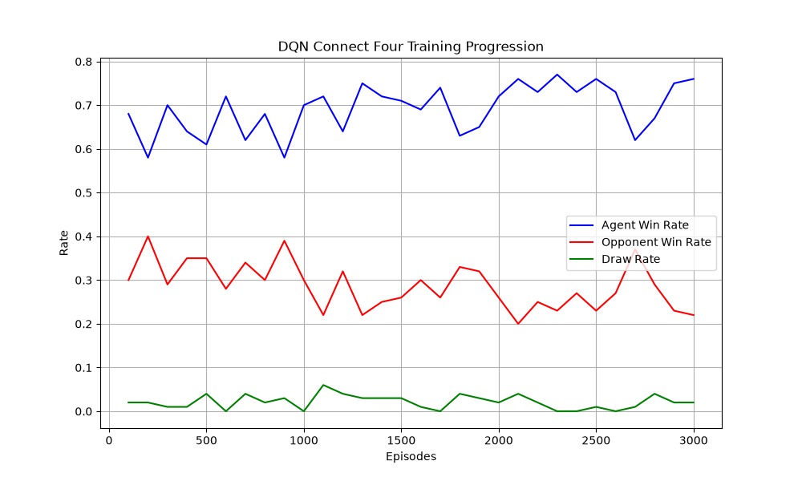

# Connect Four AI: Hybrid Deep Q-Network & Tactical Search Engine

An expert-level Connect Four artificial intelligence built with PyTorch. This project solves the massive state-space challenge of Connect Four (over 4.5 trillion board configurations) by combining the spatial pattern recognition of Deep Reinforcement Learning (DQN) with the tactical precision of an Alpha-Beta Minimax search tree.

---

## Project Overview & Engineering Approach

Traditional tabular Q-Learning works well for small games like Tic-Tac-Toe, but fails in Connect Four because storing trillions of states in a lookup table is impossible. Pure neural networks, on the other hand, understand general board positioning but often miss sudden multi-step traps.

This project bridges both worlds through three core engineering decisions:

1. **Dual-Channel Spatial Representation:**
   Instead of feeding the network a flat array of numbers where player pieces (+1 and -1) cancel each other out during math operations, the 6x7 board is split into two distinct binary channels: Channel 0 tracks the AI's pieces, and Channel 1 tracks the opponent's pieces.

2. **Custom Convolutional Neural Network (CNN):**
   The network uses 2D Convolutional layers with a 4x4 kernel filter. Because the winning condition in Connect Four requires aligning 4 discs, a 4x4 receptive field allows the network to directly scan and learn horizontal, vertical, and diagonal threats across the grid.

3. **Hybrid Alpha-Beta Lookahead (Depth 5):**
   To eliminate tactical blind spots, the trained DQN is paired with a 5-ply Alpha-Beta pruning search engine. Before expanding the search tree, the agent scans for immediate 1-step wins or forced blocks, prioritizing center columns first. When the search reaches its depth limit, it combines sliding-window heuristics with the neural network's intuition to evaluate the board.

---

## Training Progression

The model was trained across 3,000 episodes using self-play, Experience Replay (to break correlation between consecutive moves), and a frozen Target Network (updated every 250 steps to stabilize Q-value convergence).

---

## Benchmark Results

The hybrid agent was evaluated across automated test suites, achieving complete dominance as both First Player (Red) and Second Player (Yellow):

- **vs. Random Opponent (Player 1 - Red):** 100.0% Win Rate (100 Wins / 0 Losses / 0 Draws)
- **vs. Random Opponent (Player 2 - Yellow):** 100.0% Win Rate (100 Wins / 0 Losses / 0 Draws)
- **vs. Pure Heuristic Minimax (Player 1 - Red):** 100.0% Win Rate (20 Wins / 0 Losses / 0 Draws)
- **vs. Pure Heuristic Minimax (Player 2 - Yellow):** 100.0% Win Rate (20 Wins / 0 Losses / 0 Draws)

---

## Repository Structure

- **connect_four_env.py:** Custom 6x7 game environment handling state transitions, valid action masks, and directional win detection.
- **dqn_agent.py:** Core AI module containing the Conv2D Q-Network, Experience Replay Buffer, and the 5-ply Alpha-Beta search engine.
- **train_dqn.py:** Training pipeline implementing epsilon-greedy exploration, reward shaping, and Huber (Smooth L1) loss optimization.
- **evaluate_dqn.py:** Automated 200-game evaluation suite against randomized baselines.
- **eval_vs_minimax.py:** Head-to-head tournament script pitting the Hybrid DQN against a classical heuristic Minimax engine.
- **gui_connect_four.py:** Interactive graphical user interface built with Pygame, featuring mouse tracking, side selection, and instant replay.
- **play_connect_four.py:** Command-line interface for playing against the AI directly inside the terminal.
- **dqn_connect4.pth:** Saved PyTorch weights of the trained convolutional network.
- **dqn_training_curve.png:** Visualization of win/loss/draw rates across training episodes.

---

## Installation & Setup

1. Clone the repository:
   git clone https://github.com/sukuinopain/connect4-dqn-agent.git
   cd connect4-dqn-agent

2. Create and activate a virtual environment:
   python -m venv .venv
   .venv\Scripts\activate

3. Install required dependencies:
   pip install torch numpy pygame matplotlib

---

## Usage

- **Launch Interactive GUI (Pygame):**
  python gui_connect_four.py

- **Play in Terminal (CLI):**
  python play_connect_four.py

- **Run Benchmark Evaluations:**
  python evaluate_dqn.py
  python eval_vs_minimax.py